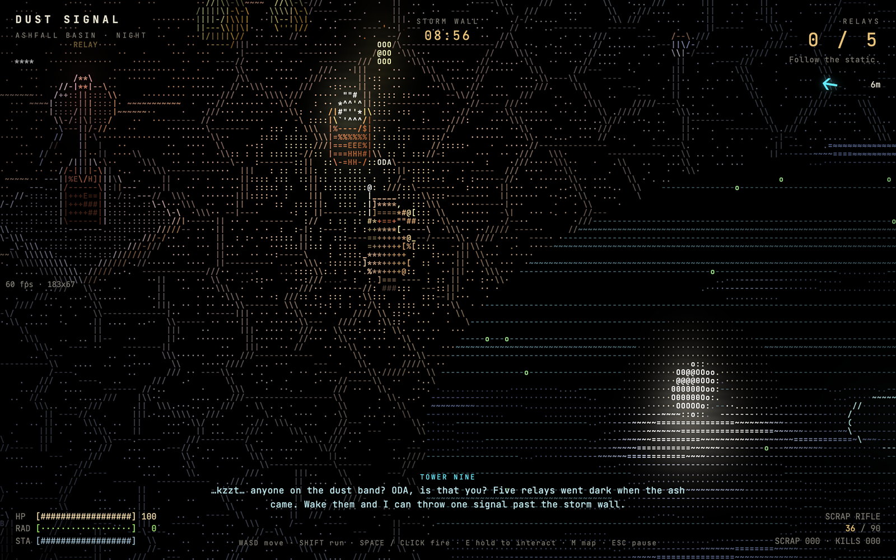
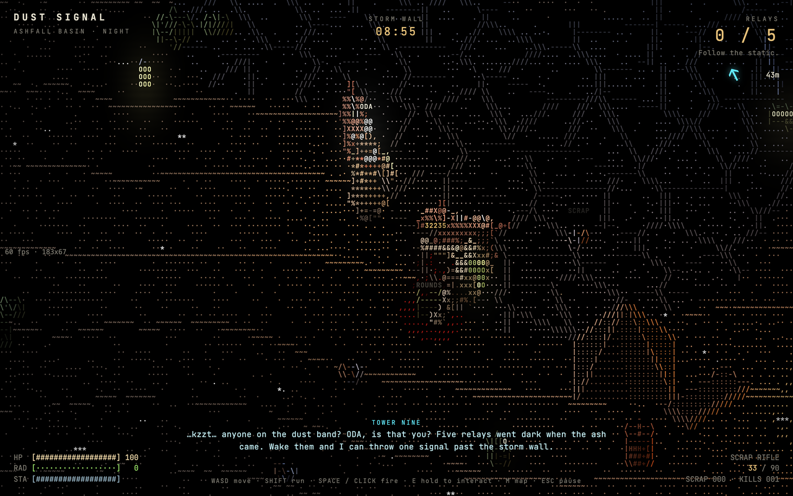
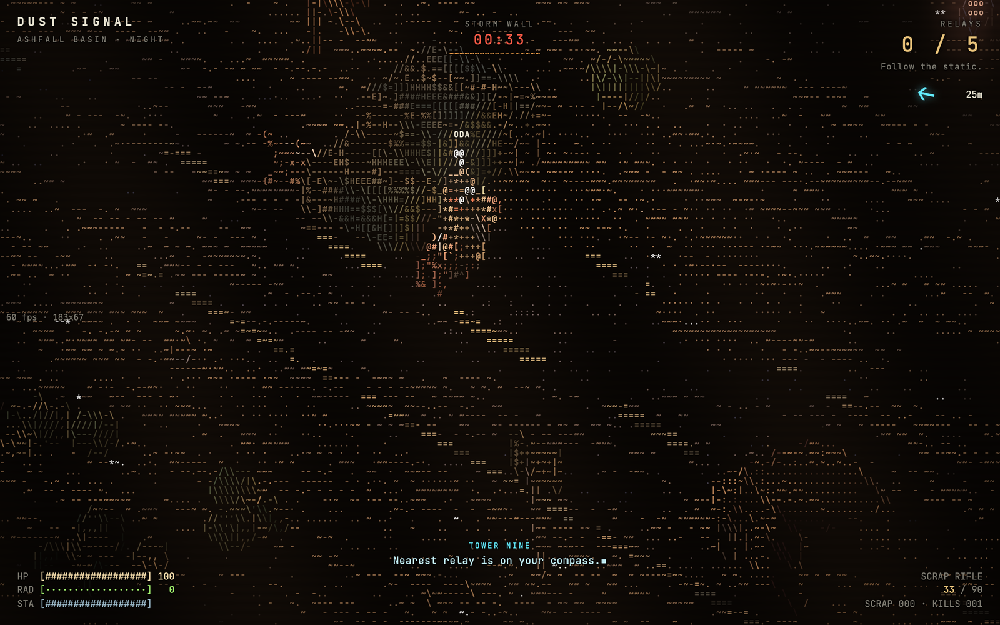

# Dust Signal

An isometric post-apocalyptic wasteland game where every pixel on screen is a text character. A real 3D world (dunes, wrecks, ruins, toxic lakes, a ribcage the size of a house) is rendered and then rebuilt cell by cell out of glyphs, in the browser, at 60 fps.

**Play it: <https://qc20.github.io/Dust-Signal/>**



## The run

The ash came and the Ashfall Basin went quiet. Five radio relays on the dust band are dark. Reboot each one, reach Tower Nine and hold the transmitter until the whole basin hears it. You have nine minutes before the storm wall arrives.

- Rot hounds and husks roam the basin. They come at you when you make noise, and they come in waves when a relay wakes up.
- The green lakes reflect the moon and the ruins around them. They are also radioactive. Radiation lowers your maximum health, and iodine brings it back down.
- Ammo, medkits, iodine and scrap lie around ruins and drop from kills. When the rifle is empty you fight with a pipe.
- As the storm builds, visibility shrinks, the air fills with blown sand, and more enemies arrive.



## Controls

| Input | Action |
| --- | --- |
| `W A S D` / arrows | Move (screen-relative) |
| `Shift` | Run (uses stamina) |
| `Space` / left click | Fire toward the cursor, or where you face (with aim assist). Swings the pipe when you are out of ammo |
| `E` (hold) | Reboot a relay / transmit from Tower Nine |
| `M` | Map |
| `[` `]` | Glyph density (fine, normal, coarse, chunky) |
| Mouse wheel | Zoom |
| `N` | Sound on/off |
| `G` | Toggle shape-matched glyphs |
| `Esc` / `P` | Pause (`R` restarts) |

On phones and tablets a virtual stick plus fire, interact and run buttons appear.

## How the ASCII look works

Nothing is a sprite. Each frame runs a small pipeline in WebGL2 (three.js):

```text
 mirrored world ──► reflection target ─┐
                                       ├─► cell pass ─► glow (MRT) ─► blur ─┐
 world ──► scene target (MRT) ─────────┘   one fragment per                  ├─► glyph pass ─► screen
          color + material id               character cell                   │
          normal + depth                                         glyph atlas ┘
```

1. **Scene pass.** The world renders at 2 x 3 samples per character cell into two targets at once. The first holds lit color plus a material ID. The second holds view normal plus depth.
2. **Reflection pass.** The whole world is mirrored across the water plane and rendered again. The toxic lakes sample it with ripple distortion. The sky in the reflection is drawn in the shader, so the moon and clouds stay anchored to the camera.
3. **Cell pass.** One fragment per character decides that cell's glyph and color.
   - **Edges.** A depth Laplacian, normal discontinuities and a structure tensor pick `| / - \` along silhouettes and creases.
   - **Shape vectors.** Each glyph's ink is measured in a 2 x 3 grid. Character silhouettes and high-contrast cells pick the glyph whose shape best matches the sub-cell coverage, instead of using a brightness ramp.
   - **Material vocabularies.** Each surface has its own set of characters:
     - Sand is sparse dithered dots with wind ripples and glinting glass shards.
     - The lakebed shows Voronoi cracks drawn as line glyphs.
     - Concrete is a dense letter mosaic with mortar courses.
     - Rust, steel and bone each have their own set.
     - Scrub blades sway with the wind.
     - Fire flickers between `' ^ * " #`.
   - **Water.** Dashed scan rows, reflected glyphs, the moon, and expanding ripple rings drawn as `( ) / \ ~` around wading feet.
   - **Decals and storm.** Footprints and blood are depth-correct because they are tested against the reconstructed world position. The storm adds wind-aligned dust streaks.
4. **Glow and glyph pass.** Only emissive things glow (fire, lamps, eyes, the moon). The final pass stamps glyphs from a runtime-generated atlas and adds glow, a dust haze and a light vignette.

The camera snaps to whole character cells, so static scenery keeps exactly the same glyphs while you move. That removes the crawling look that naive ASCII filters have. HUD text, name tags, particles and prompts are written into the same character grid, so they glow and align with the world.



## Inspiration

This project combines ideas from several places:

- **Ansenjeo's "ASCII MMORPG" water reflection test**, the TikTok that started this. It inspired the tall grass, the pond reflections, the name tag above the player, and the comment that the moon should follow the camera.
- **Alex Harri, [ASCII characters are not pixels](https://alexharri.com/blog/ascii-rendering).** Glyph selection by shape vectors with contrast enhancement.
- **Acerola's ASCII shader video**, as reimplemented in [p5js-edge-detection-ascii-renderer](https://github.com/humanbydefinition/p5js-edge-detection-ascii-renderer). Directional edge glyphs from Sobel gradients. The edge strength idea comes from Winnemöller's [XDoG paper](https://www.cs.princeton.edu/courses/archive/spring15/cos426/papers/Winnemoeller12.pdf).
- **Brogue.** Shimmering colour jitter on fire and water.
- **Cogmind.** Glyph particles and restraint with background colour.
- **Asciicker.** Proof that a full 3D world built from characters can be played.

## Run it locally

Requires Node 18 or newer.

```bash
npm install
npm run dev        # http://localhost:5173
npm run build      # static build in dist/
```

URL flags: `?seed=123` for a different world, `?density=0..3` for glyph size, `?fps` for a frame counter, `?autostart` to skip the title.

## Project layout

```text
src/engine/   renderer, shaders, glyph atlas, iso camera, overlay grid, input, procedural audio
src/game/     world generation, collision, models, game loop and rules, HUD
```

Everything, including sound, is generated at runtime. There are no image or audio assets.

## License

Apache 2.0, see [LICENSE](LICENSE).
